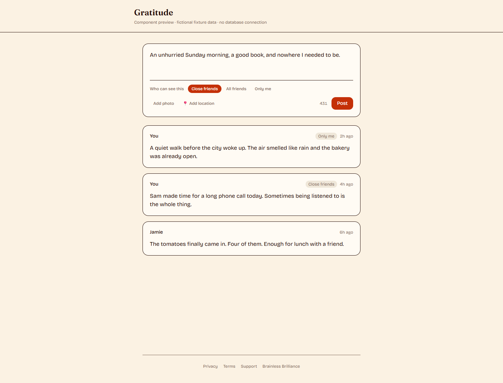
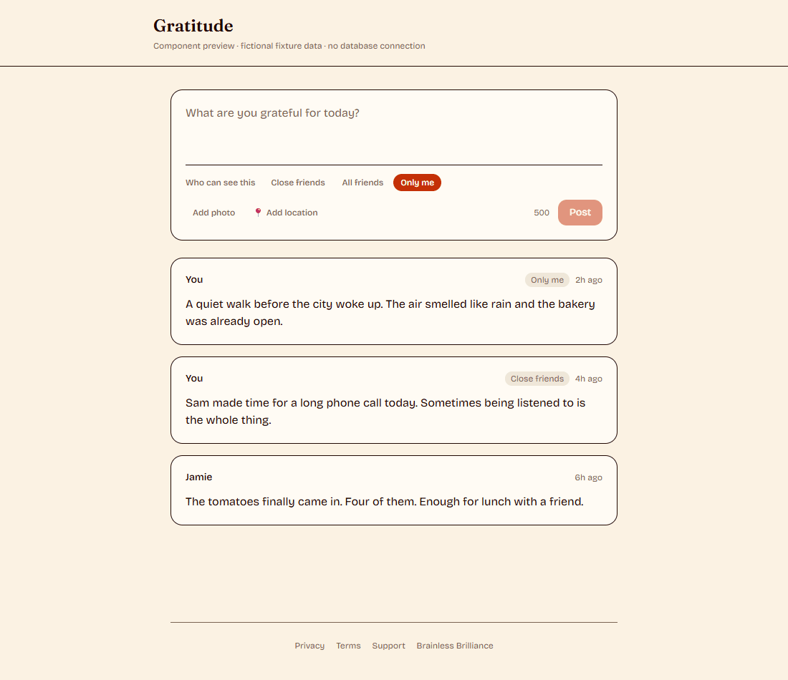
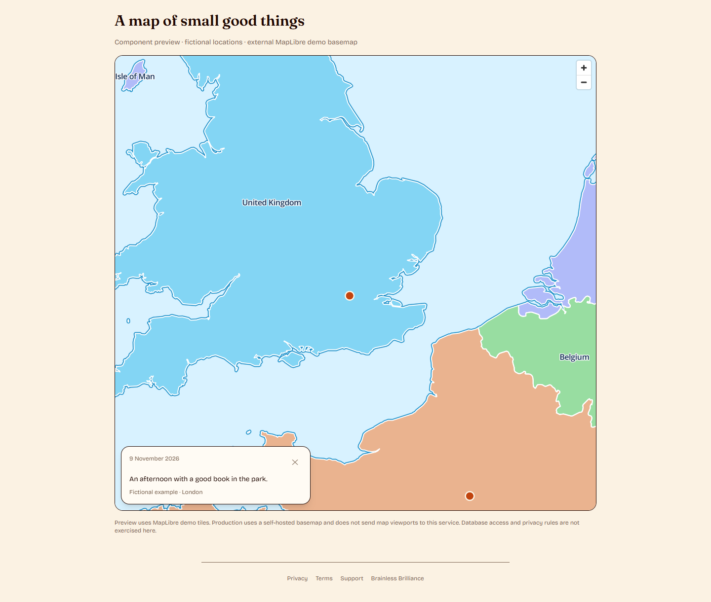

# Gratitude

Write what you're grateful for. Share it with close friends, all friends, or nobody.
Every gratitude can remember where you were — on a map only you can see.

A deliberate rewrite of the original `gratitude` app, stripped to the idea. Streaks,
stories, badges, quotes, partner spaces, reactions and comments are all gone.

## What it does

- **Post** a gratitude: 500 characters, one optional photo, one optional location.
- **Share** it with `close` friends, `friends` (all of them), or `private` (just you).
- **Friends** with a close/general tier, and a request/accept flow.
- **A private map** of your own gratitudes. Nobody else ever sees a location.

## Preview

Actual application components with fictional fixture data. These previews show
the interface and audience controls, not a verified database-backed session.







The map screenshot uses an external MapLibre demonstration basemap only in the
preview harness; production keeps its self-hosted map. See the
[capture notes](scripts/portfolio-preview/README.md),
[mobile view](docs/media/feed-mobile.png) and [sign-in screen](docs/media/login.png).

## Quick start

Requires Node 24 and Docker with Linux containers. For a lightweight walkthrough
and publication notes, see [PUBLIC_RELEASE.md](PUBLIC_RELEASE.md). Registration,
posting and friends work without the optional map archive.

```bash
npm ci
npm run db:start              # the local Supabase stack (~12 containers)
cp .env.example .env          # fill from: npx supabase status -o env
npm run dev
```

Open http://localhost:3000 and create fictional local accounts. To enable the
map basemap, run `npm run tiles:fetch` on Linux/WSL (about 17GB); see "The map"
below. No external tile service is used as a fallback.

## Where things live

Auth, the database and photo storage are a **Supabase project**. The app is a
Next.js server you host yourself, behind your own nginx. The basemap is 17GB of
tiles on your own disk.

That split is deliberate and worth stating plainly, because this app's whole
argument is about who learns what: **your users' posts and coordinates live on
Supabase's infrastructure.** Not on their tile server's, not on any CDN's — but
not on your hardware either. The map is the one thing that didn't move, because a
tile request would tell a third party where someone is *looking*, and that was
never worth outsourcing. Everything else was a trade made knowingly: managed auth,
password reset, RLS and Storage, in exchange for the data sitting in someone
else's Postgres.

"Only you can see this" remains true of your *users*. It is no longer true of your
*stack*.

## Three decisions worth knowing about

### Location is owner-only, structurally

Coordinates are never shown to anyone but their author — regardless of who the post
is shared with. Location is a *private annotation* on a *possibly-shared* object.

That isn't enforced by remembering to strip a field. It's enforced four ways:

1. **`post_locations` is a separate table.** A query that doesn't deliberately join
   to it *cannot* return coordinates. A `latitude` column on the post would leak
   the moment someone selected `*`. This fails safe instead of failing open.
2. **`FEED_POST_COLUMNS` omits it** (`src/server/posts/select.ts`). PostgREST
   returns exactly the columns you ask for and embeds only the relations you name,
   so asking for what you mean is what keeps coordinates in the database.
3. **RLS**: `locations are readable only by the post's author`. There is no
   `friends` branch in that policy — not a stricter one, none at all.
4. **The map is its own query**, hard-scoped to `author_id = viewer.id`, with no
   viewer branch to get wrong.

A friend's view of a geotagged post carries no location key at all — not `null`,
which would still reveal *that* a post is geotagged.
`tests/e2e/privacy.spec.ts` checks this against the API a friend's own browser
receives, not against the rendered page: the question is whether the coordinates
were ever sent, not whether they were displayed.

### Photos are re-encoded, not stored

Every upload is re-encoded with sharp (`src/server/media/process.ts`), which drops
all metadata including EXIF GPS. The original app wrote the raw client buffer to
disk and served it from a public URL, so a photo's own GPS tags went out with it —
a friend could download the file and read the coordinates straight out of it,
walking past every database privacy rule. Owner-only coordinates in Postgres mean
nothing if they also ride along inside the JPEG.

This is why photos are **uploaded through this server**, not straight from the
browser to Storage — which is the idiomatic Supabase shape, and would put the
original JPEG in the bucket with its GPS intact. `processImage()` re-encodes
first, and it can only do that here.

And they're **served through this server too**. The bucket is private, with no
storage policies for anyone: `/api/media/[id]` is the only door. The id in that
path is the *post's* id, and the lookup runs through the posts RLS policy as the
viewer — so "may I see this photo" is by construction the same question as "may I
see this post". A public bucket would be v1's mistake again; a signed URL is a
bearer token that works for whoever ends up holding it, which is not the same as
"as visible as the post it belongs to".

Photos are served through `/api/media/[id]`, behind the same visibility predicate as
their post — not as static files.

### The map is self-hosted

`npm run tiles:fetch` downloads a 17GB `.pmtiles` archive of the whole globe (z0–12)
into `public/tiles/` (gitignored). Map glyphs are in `public/fonts/`.

This is the point of the feature, not an optimisation. Every tile request tells the
tile server your IP and your viewport, and a private gratitude map opens centred on
your own pins — so the first request to a third party would amount to "this person
lives here", before you've touched anything. Serving tiles from our own origin means
no tile server learns anything at all. `scripts/verify-map.ts` asserts it: it loads
the map in a real browser and fails if a single request leaves our origin, or if the
canvas comes back blank.

Hosting 17GB does not mean serving it. pmtiles reads single tiles over HTTP range
requests, so a first visit costs ~500KB and panning across a country ~5MB, cached
immutable for a week. You never send the archive; you send the handful of tiles
someone looked at.

Zoom is what the globe costs: 17GB at z12, 35GB at z13, 68GB at z14 — measured with
`pmtiles extract --dry-run`, which prices any change before you pay for it. z12 is
neighbourhood detail, not street. Want street level somewhere specific? Narrow
`REGION.bbox` in `scripts/fetch-tiles.ts` and raise `maxzoom`.

**The archive is checked, never trusted.** An interrupted extract doesn't fail — it
leaves a file of exactly the right length whose missing regions are holes that read
back as zeros. Right size, valid header, `pmtiles verify` passes in milliseconds
because it only reads the header and directories. Downstream, MapLibre asks for a
tile, gets zeros, gzip refuses them, and the map renders grey with no error anyone
can act on. That shipped once and cost an evening. So `fetch-tiles.ts` reads real
tiles back and checks the gzip magic before it says "Done".

## Architecture

One Next.js app. Not a monorepo, no separate API server, no shared package — v1 is
~20 endpoints and the split was pure overhead.

```
src/
  app/          routes + thin API adapters
  components/
  server/       all the logic, framework-free
    posts/visibility.ts   <- the one privacy predicate
    posts/select.ts       <- the selects that keep coordinates in the database
    media/                <- validate / re-encode / store
    location/normalize.ts <- 3dp rounding, Null Island rejection
```

Everything in `src/server/**` is plain `(viewerId, args)` functions that know nothing
about Next, so route handlers stay 5-line adapters — and a mobile client later can
reuse them.

### Privacy lives in exactly one place

`private.can_see_post(author, visibility)` — a Postgres function, behind the RLS
policy on `posts`. Feed, single-post reads and media serving all go through it,
because they all go through the database. See
`supabase/migrations/20260716024735_init_gratitude_schema.sql`.

It replaced `visiblePostsWhere()`, a Prisma `WhereInput` that did the same job in
TypeScript. Two of the three reasons that function existed survive the move:
Postgres still applies the rule *before* the limit, so the feed can't repeat v1's
pagination bug (where `take + 1` ran before an in-memory privacy filter and
`hasMore` was measured after it — on a half-private feed, 11 of 30 posts and a
dead stop after one page); and it still restricts the author set as a side
effect, so the feed *is* the predicate.

The third reason doesn't survive, and it's worth being honest about: `private`
used to be unreachable **by construction** — there was no branch to forget. It is
now unreachable **because the policy is correct**. That's a weaker guarantee, and
it's why `tests/e2e/privacy.spec.ts` — which drives two real signed-in browsers
and checks what each can actually see — matters more than it used to.

`SECURITY DEFINER` on that function is load-bearing, not lazy. An RLS policy's
subquery has the referenced table's RLS applied to it, so an inline
`exists (select 1 from friends …)` could only ever see the *viewer's* friend rows,
never the author's — and every friend's post would silently vanish. Letting people
read friend rows where they're the target would fix that and leak the author's
`tier` for them, which is exactly what the tier is not allowed to do.

### Friend tiers are one-sided

`close` is *your* label for someone. You can mark Mel close while she marks you
general — she still sees your close posts, and you don't see hers. It's your list,
not a mutual status.

Friendships are stored as **two mirrored rows**, written and deleted as a pair, so
the privacy check is one indexed `EXISTS`. Because a pair means writing a row you
don't own, RLS can't express it: every write goes through a `SECURITY DEFINER`
RPC (`send_friend_request`, `accept_friend_request`, `remove_friend`) that reads
`auth.uid()` itself and takes no "acting as" argument. Without that check, anyone
who learned a request id could befriend two strangers to each other. All of it
lives in `src/server/friends/service.ts` and the RPC migration — nothing else
touches the `friends` table.

## Commands

```bash
npm run db:start      # the local Supabase stack — start this first
npm run dev

npm run test          # 11 unit tests; pure logic, no database
npm run test:e2e      # 64 end-to-end tests; drives real browsers
npm run typecheck
npm run lint
npm run build

npm run db:stop / db:reset
npm run db:types      # regenerate src/generated/database.types.ts after a migration
npm run tiles:fetch
npx tsx scripts/verify-map.ts   # zero external requests, and the map actually draws
```

Copy `.env.example` to `.env` and fill it from `npx supabase status -o env`. The
default local keys are development credentials, never credentials for a hosted project.

**Dev and the e2e suite point at the local stack, never at the hosted project.**
The suite registers accounts on every run; against the hosted project those would
be real users in production, forever. Studio is on `:54323`, and Mailpit — which
catches every email the app sends, including reset links — is on `:54324`.

### Where the tests are

The unit suite is small on purpose. It covers what's still pure: cursor encoding,
the ~110m coordinate rounding, magic-byte image sniffing. The 41 tests that used
to sit beside it tested `visiblePostsWhere`, Prisma pagination and local-disk
media — every one of those subjects now lives in Postgres, so they were retired
rather than rewritten to assert the same thing twice. The rules are covered where
they live: `tests/e2e/privacy.spec.ts` drives two signed-in browsers and checks
what each can actually see.

## Not built yet

A mobile client, and post editing.

Password reset ships — `/forgot-password`, a PKCE link, `/reset-password`. But the
hosted project still uses Supabase's default SMTP, which allows **2 emails an
hour**. That's fine for a handful of people and not fine for public signup:
configure custom SMTP first.
